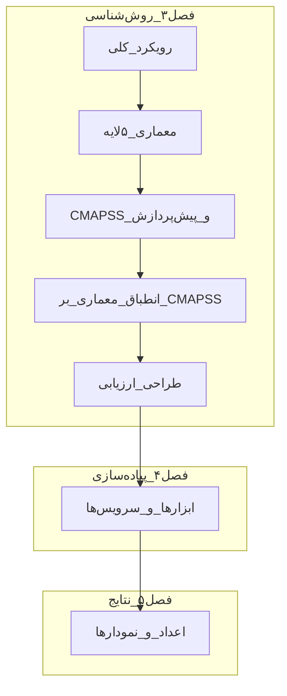

---
name: Chapter3 Outline Plan
overview: پلن فصل سوم با اصلاح مفهوم کم‌برآورد، الزام رفرنس، و رعایت دقیق skillهای نگارش فارسی/ادبیات، علائم، یکنواختی و انسجام متن.
todos:
  - id: confirm-outline
    content: تأیید/تعدیل سرفصل‌های فصل ۳ توسط کاربر
    status: pending
  - id: ensure-bib-refs
    content: بررسی رفرنس‌های skill/literature-map و افزودن کلیدهای غایب به my_ref.bib پیش از/هنگام نگارش
    status: pending
  - id: draft-architecture
    content: نگارش بخش معماری پنج‌لایه + شکل‌ها با رعایت skill نگارش و یکنواختی اصطلاحات
    status: pending
  - id: draft-cmapss
    content: نگارش توصیف CMAPSS و پیش‌پردازش با استناد و قراردادهای LaTeX/فارسی
    status: pending
  - id: draft-agents-mapping
    content: "نگارش انطباق معماری: LSTM، loss ناهم‌تراز (سوق به کم‌برآورد)، پایش، LLM"
    status: pending
  - id: draft-eval-summary
    content: نگارش روش ارزیابی + مقدمه و جمع‌بندی با انسجام روایی نسبت به فصول ۱ و ۲
    status: pending
  - id: style-pass
    content: پاس نهایی سبک؛ نیم‌فاصله، gls/lr/cite، یکنواختی واژگان، و هم‌ترازی با خلاصه فصل ۱
    status: pending
isProject: false
---

# پلن سرفصل‌های فصل سوم: روش‌شناسی و معماری پیشنهادی

## الزامات کیفیت نگارش (الزامی قبل و حین نوشتن)

قبل از هر ویرایش روی [`chap3.tex`](Writing/Theses/IUT_Theses/chap3.tex)، skillهای زیر خوانده و اعمال شوند:

1. [`.cursor/skills/persian-thesis-writing/SKILL.md`](.cursor/skills/persian-thesis-writing/SKILL.md)
2. [`.cursor/skills/persian-thesis-writing/persian-style-guide.md`](.cursor/skills/persian-thesis-writing/persian-style-guide.md)
3. [`.cursor/skills/persian-thesis-writing/latex-conventions.md`](.cursor/skills/persian-thesis-writing/latex-conventions.md)
4. [`.cursor/skills/thesis-literature-map/SKILL.md`](.cursor/skills/thesis-literature-map/SKILL.md) برای انتخاب و تکمیل رفرنس‌ها

### لحن و دیدگاه
- رسمی، علمی، سوم‌شخص/بی‌طرف: «پژوهش حاضر»، «در این فصل» — نه «من/ما»
- جملات کوتاه تا متوسط؛ هر پاراگراف یک ایده
- تعریف/کلیات اول، سپس جزئیات طراحی

### علائم نگارشی و املاء
- نیم‌فاصله در می‌شود، نمی‌توان، پایان‌نامه، چندعاملی، بی‌درنگ، به‌صورت، به‌منظور، داده‌ها
- ویرگول و نقطهٔ فارسی (`،` `۔`)؛ گیومه « »؛ فاصلهٔ صحیح قبل از `\cite`
- اعداد فارسی در متن عادی؛ نام‌های علمی/دیتاست/سال میلادی داخل `\lr{}`
- پرهیز از ترجمهٔ تحت‌اللفظی و واژگان محاوره‌ای/تبلیغاتی

### یکنواختی اصطلاحات (با فصل‌های ۱ و ۲)
- واژگان پروژه از [`dict_acn.tex`](Writing/Theses/IUT_Theses/dict_acn.tex) با `\gls` / `\glspl`؛ کلید جدید در صورت نیاز ابتدا تعریف شود
- معادل‌های ثابت: دوقلوی دیجیتال، سیستم چندعاملی، نگهداری پیش‌بینانه، عمر مفید باقیمانده / `\gls{RUL}`، پایش، چارچوب، عامل
- نام لایه‌ها دقیقاً با کلیدهای موجود: Entity / Data Collection / Integration / Digital Twin Agents / Application Agents
- روایت کم‌برآورد در کل فصل یکدست بماند (سوگیری آگاهانه؛ نه «کاهش underestimate»)

### یکپارچگی و انسجام متن
- آغاز فصل با ارجاع به شکاف‌های فصل ۲؛ پایان با پل به فصل ۴
- هر `\section` با جملهٔ هدف بخش شروع شود؛ زیربخش‌ها بدون پرش موضوعی پشت سر هم بیایند
- شکل/جدول فقط وقتی ارجاع متنی دارند (`شکل \ref{...}`)
- تکرار مبانی فصل ۲ ممنوع؛ فقط ارجاع کوتاه + `\cite`
- ادعاهای طراحی با پیاده‌سازی واقعی (`Implementation/`) ناسازگار نباشد
- پس از اتمام پیش‌نویس: یک پاس سبک مستقل برای نیم‌فاصله، `\gls`/`\lr`/`\cite`، و هم‌ترازی با خلاصه فصول فصل ۱

## اصلاح مفهومی الزامی: کم‌برآورد (Underestimate)

در این پژوهش هدف **کاهش underestimate نیست**. چالش کم‌برآورد در ادبیات به‌عنوان مسئله شناخته می‌شود، اما طراحی تابع هزینهٔ این پایان‌نامه آگاهانه خطاها را **به سمت کم‌برآورد سوق می‌دهد** تا اگر پیش‌بینی اشتباه باشد، عمر باقی‌مانده **کمتر از واقعیت** برآورد شود نه بیشتر.

- **منطق صنعتی:** بیش‌برآورد RUL خطرناک‌تر است؛ ممکن است نگهداری دیر انجام شود و خرابی واقعی هزینه/ریسک بسیار بالایی ایجاد کند.
- **منطق محافظه‌کارانه:** کم‌برآورد ممکن است نگهداری زودتر پیشنهاد دهد، اما از شکست ناگهانی جلوگیری می‌کند.
- **در نگارش:** هرگز ننویسید «کاهش underestimate» یا «رفع چالش کم‌برآورد». بنویسید «سوگیری آگاهانه به سمت کم‌برآورد / ترجیح خطای underestimate بر overestimate / وزن‌دهی نامتقارن خطا».

## سیاست رفرنس‌دهی (الزامی در نگارش)

استفاده از رفرنس‌ها در فصل ۳ باید جدی و پیوسته باشد؛ ادعاهای معماری، داده، مدل و تابع هزینه بدون `\cite` رها نشوند.

1. منبع اولویت‌دار رفرنس‌ها: [`my_ref.bib`](Writing/Theses/IUT_Theses/my_ref.bib) + literature map در [`.cursor/skills/thesis-literature-map/`](.cursor/skills/thesis-literature-map/)
2. اگر مقالهٔ مورد نیاز از skill/catalog در `my_ref.bib` نیست، **قبل از یا همزمان با نگارش** ورودی BibTeX کامل اضافه شود و همان کلید در متن استفاده شود.
3. برای لایه‌ها، MA-DT، DT+LLM، CMAPSS، LSTM-RUL و loss نامتقارن حداقل یک لنگر استنادی در هر زیربخش کلیدی بیاید.
4. از ادعای بدون منبع یا «مثلاً فلان مقاله» بدون کلید واقعی پرهیز شود.

## مرز فصل‌ها (تصمیم پایه)

فصل سوم **طراحی مفهومی + روش‌شناسی قابل‌استناد** است؛ نه کد/ابزار و نه نتایج عددی.

| فصل | نقش |
|-----|-----|
| ۳ | معماری پنج‌لایه، نقش عامل‌ها، جریان داده، CMAPSS، پیش‌پردازش، طراحی مدل LSTM و تابع هزینه، طراحی تعامل LLM، معیارهای ارزیابی |
| ۴ ([chap4.tex](Writing/Theses/IUT_Theses/chap4.tex)) | ابزارها (Python/Keras، Docker، Dify)، پیاده‌سازی گام‌به‌گام، استقرار |
| ۵ ([chap5.tex](Writing/Theses/IUT_Theses/chap5.tex)) | RMSE/MAE/R²، نمودارها، نمونه‌های پرسش‌وپاسخ، مقایسه با ادبیات |

این مرز همان چیزی است که در خلاصه فصول فصل ۱ وعده داده شده و با اسکلت فعلی [chap3.tex](Writing/Theses/IUT_Theses/chap3.tex) هم‌خوان است؛ فقط سرفصل‌ها را غنی‌تر و دقیق‌تر می‌کنیم.

---

## سرفصل پیشنهادی (ساختار نهایی فایل)

فایل هدف: [`Writing/Theses/IUT_Theses/chap3.tex`](Writing/Theses/IUT_Theses/chap3.tex)

### ۳-۱ مقدمه / رویکرد کلی پژوهش
**محتوا:**
- پیوند مستقیم با شکاف‌های فصل ۲ (تعامل زبانی ضعیف، کمبود توضیح‌پذیری، هزینهٔ نامتقارن خطای RUL، تمرکز صرف بر دقت LSTM بدون تحلیل حسگر)
- سه مرحله روش‌شناسی: طراحی مفهومی معماری → نمونه‌سازی آزمایشگاهی روی CMAPSS → ارزیابی تجربی با معیارهای تعریف‌شده
- سؤال‌های پژوهشی قابل‌پاسخ در این فصل (چگونه پنج لایه نقش‌ها را جدا می‌کنند؟ چگونه LSTM و LLM در لایه کاربرد هم‌زیستی دارند؟ چگونه سوگیری محافظه‌کارانهٔ کم‌برآورد و توضیح‌پذیری در طراحی لحاظ می‌شود؟)
- اعلام صریح سطح بلوغ هدف: حرکت از Digital Twin Shadow به‌سوی Digital Twin دوطرفه در شبیه‌سازی (هم‌راستا با فصل ۲)
- در همین بخش یک پاراگراف کوتاه مفهوم «ترجیح کم‌برآورد بر بیش‌برآورد» را با استناد معرفی کند تا در ۳-۴ تکرار مبهم نشود

**شکل پیشنهادی:** نمودار جریان کلی پژوهش (طراحی → داده → عامل‌ها → ارزیابی)

---

### ۳-۲ معماری پیشنهادی دوقلوی دیجیتال چندعاملی
**محتوا:** معرفی کلان معماری پنج‌لایه با یک شکل مرجع، سپس زیربخش برای هر لایه. اصطلاحات از [`dict_acn.tex`](Writing/Theses/IUT_Theses/dict_acn.tex): `\gls{EmtityLayer}`, `\gls{DataCollectionLayer}`, `\gls{IntegrationLayer}`, `\gls{DigitalTwinAgentsLayer}`, `\gls{ApplicationAgentsLayer}`.

#### ۳-۲-۱ نمای کلی و اصول طراحی
- جداسازی مسئولیت‌ها (separation of concerns)
- استقلال عامل‌ها + همکاری از طریق قراردادهای پیام
- مقیاس‌پذیری با افزودن عامل جدید در لایه کاربرد
- ارجاع با کلید واقعی BibTeX به ادبیات MA-DT و DT+LLM (از جمله `\cite{park2025interactive}`، `\cite{CHEN2025102982LLMDT}` و مقالات مشابه؛ در صورت نبود کلید در `my_ref.bib` ابتدا اضافه شود)

#### ۳-۲-۲ لایه موجودیت (Entity)
- موجودیت فیزیکی هدف: موتور توربوفن (در این پژوهش شبیه‌سازی‌شده با CMAPSS)
- نگاشت مفهومی Physical Entity / Digital Model / Data Connection به این لایه
- محدودیت: داده واقعی حسگر صنعتی در دسترس نیست؛ موجودیت با موتورهای FD00x شبیه‌سازی می‌شود

#### ۳-۲-۳ لایه جمع‌آوری داده (Data Collection)
- نقش: دریافت چرخه‌ای اندازه‌گیری‌های عملیاتی و حسگرها
- در حالت واقعی: IoT/SCADA؛ در این پژوهش: خواندن/استریم فایل‌های CMAPSS و شبیه‌سازی جریان بی‌درنگ
- کیفیت داده، نرخ نمونه‌برداری مفهومی، و جدا بودن جمع‌آوری از تحلیل

#### ۳-۲-۴ لایه ادغام (Integration)
- نرمال‌سازی، همگام‌سازی زمانی، ساخت پنجره‌های زمانی، انتشار وضعیت یکپارچه به عامل‌های بالاتر
- نقش «قرارداد داده» بین لایه‌ها (schema وضعیت موتور: شناسه، چرخه، حسگرها، وضعیت RUL تخمینی)

#### ۳-۲-۵ لایه عامل‌های دوقلوی دیجیتال (DT Agents)
- عامل(های) نگه‌دارنده وضعیت زنده موتور: twin state
- به‌روزرسانی حالت دیجیتال بر اساس داده ادغام‌شده
- ارائه API/وضعیت خواندنی برای لایه کاربرد (نه منطق پیش‌بینی سنگین در همین لایه)

#### ۳-۲-۶ لایه عامل‌های کاربرد (Application Agents)
معرفی انتزاعی چهار نقش اصلی (جزئیات طراحی در ۳-۴):
1. عامل پیش‌بینی RUL مبتنی بر LSTM
2. عامل پایش/مانیتورینگ
3. عامل تعامل زبانی مبتنی بر LLM
4. عامل شبیه‌سازی/تزریق داده بی‌درنگ (برای بستن حلقه آزمایشگاهی)

#### ۳-۲-۷ جریان تعامل و پروتکل ارتباطی
- جریان داده صعودی: Entity → Collection → Integration → DT → Application
- جریان فرمان/بازخورد نزولی: LLM/Monitoring → DT → (در حالت ایده‌آل) کنترل موجودیت
- سناریوی نمونه: «کاربر می‌پرسد RUL موتور k چیست → LLM → Prediction Agent → پاسخ توضیح‌پذیر»

**شکل‌های ضروری این بخش:**
1. دیاگرام پنج‌لایه
2. توالی تعامل عامل‌ها (sequence diagram)
3. (اختیاری) نمودار مؤلفه‌ای سرویس‌ها در سطح منطقی — بدون Docker/Dify

---

### ۳-۳ مجموعه داده CMAPSS و آماده‌سازی داده
**محتوا:** داده مبنا را کامل معرفی کند تا فصل ۴ فقط «چگونه در کد اعمال شد» بگوید.

#### ۳-۳-۱ معرفی و ساختار
- منبع NASA C-MAPSS؛ چهار زیرمجموعه FD001–FD004
- تفاوت شرایط عملیاتی و حالت‌های خرابی بین زیرمجموعه‌ها
- انتخاب زیرمجموعه(های) آزمایش در این پژوهش (پیش‌فرض پیشنهادی برای نگارش: تمرکز اصلی روی FD001، با ذکر قابلیت تعمیم؛ اگر در پیاده‌سازی چند FD دارید، همان را صریح بنویسید)
- ستون‌ها: unit, time/cycle, settings، سنسورها؛ تعریف برچسب RUL

#### ۳-۳-۲ چالش‌های داده
- نویز سنجش، چندحالتی بودن برخی FDها، طول عمرهای متفاوت موتورها
- پیوند با شکاف فصل ۲ دربارهٔ هزینهٔ نامتقارن خطای RUL: بیش‌برآورد عمر می‌تواند به تصمیم نگهداری دیرهنگام و خرابی پرهزینه بینجامد؛ بنابراین در طراحی بعدی، سوگیری به سمت کم‌برآورد آگاهانه تعریف می‌شود (نه ادعای «حذف/کاهش underestimate»)

#### ۳-۳-۳ پیش‌پردازش
- برچسب‌گذاری RUL (و در صورت استفاده: سقف‌گذاری early RUL / piecewise)
- نرمال‌سازی ویژگی‌ها
- انتخاب/حذف حسگرهای کم‌اطلاعات
- ساخت توالی با طول پنجره برای LSTM
- تقسیم train/test مطابق پروتکل استاندارد CMAPSS

**جدول پیشنهادی:** مشخصات FDها + تعداد موتور آموزش/آزمون  
**شکل پیشنهادی:** نمونه سری زمانی یک موتور قبل/بعد نرمال‌سازی

---

### ۳-۴ انطباق معماری پیشنهادی بر مسئله CMAPSS
این بخش قلب فصل است: «چگونه معماری عمومی روی این داده و این اهداف می‌نشیند».

#### ۳-۴-۱ نگاشت لایه‌ها به اجزای مسئله
جدول نگاشت: هر لایه → ورودی/خروجی → مصداق CMAPSS

#### ۳-۴-۲ طراحی عامل پیش‌بینی (LSTM)
- مسئله به‌صورت رگرسیون RUL روی پنجره‌های زمانی
- معماری مفهومی شبکه (دو لایه LSTM + Dropout + Dense) — جزئیات hyperparameter و کد در فصل ۴
- **طراحی تابع هزینه ناهم‌تراز برای سوق‌دادن خطا به سمت کم‌برآورد** (نوآوری وعده‌داده‌شده در فصل ۱/۵): تعریف ریاضی وزن‌دهی نامتقارن طوری که جریمهٔ بیش‌برآورد RUL سنگین‌تر از کم‌برآورد باشد؛ در نتیجه اگر مدل خطا کند، تمایل داشته باشد عمر باقی‌مانده را کمتر برآورد کند نه بیشتر
- توجیه صنعتی با استناد: جلوگیری از هزینه/ریسک خرابی ناشی از خوش‌بینی بیش از حد به عمر باقی‌مانده؛ کم‌برآورد ممکن است نگهداری زودتر پیشنهاد دهد اما از شکست ناگهانی پرهزینه پیشگیری می‌کند
- ارجاع اجباری به ادبیات مربوط (از جمله `\cite{nguyen2025underestimate}` و منابع loss نامتقارن/Score ناسا در صورت وجود؛ کلید غایب به `my_ref.bib` اضافه شود)
- خروجی عامل: RUL تخمینی + در صورت وجود، سیگنال اطمینان/آستانه هشدار
- **هشدار نگارشی:** از عبارت‌هایی مثل «کاهش underestimate» یا «حل چالش کم‌برآورد» استفاده نشود

#### ۳-۴-۳ طراحی توضیح‌پذیری و تحلیل سهم حسگرها
- روش مفهومی شناسایی حسگرهای مؤثر بر پیش‌بینی هر موتور (مثلاً حساسیت/اهمیت ویژگی روی ورودی پنجره؛ بدون نمودار نتایج)
- اتصال این خروجی به LLM برای تولید توضیح زبان طبیعی («چرا RUL موتور X پایین است»)

#### ۳-۴-۴ طراحی عامل پایش بی‌درنگ
- تعریف وضعیت‌های پایش (عادی / هشدار / بحرانی) بر اساس آستانه RUL یا نرخ افت
- شبیه‌سازی استریم چرخه‌به‌چرخه از فایل‌های CMAPSS به‌عنوان جایگزین حسگر واقعی
- انتشار رویداد به عامل DT و LLM

#### ۳-۴-۵ طراحی عامل تعاملی LLM
- نقش LLM: رابط زبان طبیعی، نه جایگزین مدل RUL
- قابلیت‌های هدف: پرس‌وجوی وضعیت، درخواست پیش‌بینی، توضیح دلیل، فرمان‌های سطح‌بالا (مثلاً شبیه‌سازی خاموش/ایزوله‌کردن موتور در خطر)
- الگوی طراحی prompt/tool-calling در سطح منطقی (بدون جزئیات Dify؛ آن‌ها فصل ۴)
- مرز ایمنی: LLM فقط از طریق API عامل‌ها عمل می‌کند، نه دسترسی مستقیم به مدل خام

#### ۳-۴-۶ همگام‌سازی چندعاملی و سناریوی end-to-end
یک سناریوی کامل متنی + دیاگرام توالی: ورود چرخه جدید → به‌روزرسانی twin → پیش‌بینی → پایش → پرسش کاربر → پاسخ توضیح‌پذیر

---

### ۳-۵ روش ارزیابی طراحی‌شده (بدون نتایج)
**محتوا:** معیارها و سناریوها را اینجا تعریف کنید تا فصل ۵ فقط اعداد را گزارش کند.

- پیش‌بینی: RMSE، MAE، R²، و Score نامتقارن/تابع ناسا برای سنجش رفتار خطا
- معیار اختصاصی سوگیری خطا: نسبت یا توزیع خطاهای underestimate در برابر overestimate (نه به‌عنوان «موفقیت در کاهش کم‌برآورد»، بلکه به‌عنوان شواهد سوق‌یافتن خطا به سمت محافظه‌کارانه)
- مقایسه مفهومی با خطوط پایه ادبیات LSTM/Hybrid با `\cite` واقعی (نتیجه عددی در فصل ۵)
- ارزیابی سامانه چندعاملی: زمان پاسخ تعامل، صحت اجرای دستورات سطح‌بالا، کیفیت توضیح‌ها (نمونه کیفی)
- معیار پوشش شکاف‌ها: وجود سوگیری محافظه‌کارانهٔ طراحی‌شده، توضیح حسگرمحور، قابلیت گفت‌وگوی زبان طبیعی

---

### ۳-۶ جمع‌بندی فصل
- خلاصه معماری و نگاشت CMAPSS
- تأکید بر پوشش شکاف‌های فصل ۲ در سطح طراحی
- پل به فصل چهارم: «در فصل بعد، این طراحی با ابزارهای مشخص پیاده‌سازی می‌شود»

---

## آنچه عمداً وارد فصل ۳ نمی‌شود

- کد Keras، اسکرین‌شات Dify، `docker-compose`، لاگ استقرار → فصل ۴
- جدول مقایسه RMSE نهایی، نمودار loss آموزش، نمونه‌های واقعی chat → فصل ۵
- مرور دوباره مبانی LSTM/LLM/MAS → فصل ۲ (فقط ارجاع کوتاه)

---

## منابع و لنگرهای محتوایی برای نگارش

- وعده ساختاری فصل ۱: [chap1.tex](Writing/Theses/IUT_Theses/chap1.tex)
- شکاف‌ها: زیربخش تحلیل شکاف در [chap2.tex](Writing/Theses/IUT_Theses/chap2.tex)
- نوآوری‌های هدف: سوگیری آگاهانه به کم‌برآورد، حسگرهای مؤثر، ادغام کم‌هزینه LLM — از اسکلت [chap5.tex](Writing/Theses/IUT_Theses/chap5.tex)
- لنگر پیاده‌سازی واقعی برای هم‌خوانی ادعاها: نوت‌بوک‌های LSTM در `Implementation/jupyter-notebook/` و بکاپ‌های workflow در `Implementation/Backups/`
- ارجاع معماری/ادبیات: ترکیب‌های DigitalTwin+LLM و CMAPSS+LSTM از literature map؛ هر کلید استفاده‌شده باید در [`my_ref.bib`](Writing/Theses/IUT_Theses/my_ref.bib) موجود باشد

### گردش‌کار رفرنس هنگام نگارش هر زیربخش
1. از `query_catalog.py` / catalogهای skill نامزدهای استنادی را بگیرید
2. وجود کلید در `my_ref.bib` را چک کنید
3. اگر نیست: ورودی BibTeX را اضافه کنید (DOI/سال/عنوان کامل؛ بدون کلید جعلی)
4. در متن فارسی با فاصلهٔ صحیح قبل از `\cite{...}` بنویسید

---

## ترتیب نگارش پیشنهادی (پس از تأیید پلن)

1. خواندن skillهای persian-thesis-writing و thesis-literature-map
2. همگام‌سازی رفرنس‌های ضروری فصل ۳ با `my_ref.bib`
3. تکمیل ۳-۲ با شکل پنج‌لایه و جدول مسئولیت لایه‌ها + `\cite`
4. نگارش ۳-۳ با جداول CMAPSS و فرمول‌های پیش‌پردازش/RUL + استناد
5. نگارش ۳-۴ (LSTM + loss ناهم‌تراز با روایت صحیح کم‌برآورد + LLM + پایش)
6. نگارش ۳-۱ و ۳-۵ و ۳-۶ برای انسجام روایی
7. پاس سبک نهایی (علائم، نیم‌فاصله، یکنواختی واژگان، `\gls`/`\lr`/`\cite`) و هم‌ترازی خلاصه فصل ۳ در فصل ۱

---

## نکته دامنه جزئیات

پلن بالا سطح **معماری + روش‌شناسی کامل طراحی** است: فرمول‌ها، نگاشت عامل‌ها، و معیارها در فصل ۳؛ هایپرپارامترهای نهایی آموزش، promptهای اجرایی Dify و اعداد عملکرد در فصل‌های ۴ و ۵. اگر بخواهید فصل ۳ سبک‌تر (فقط معماری بدون طراحی loss/ارزیابی) یا سنگین‌تر (قابل‌بازتولید کامل با همه تنظیمات) باشد، قبل از شروع نگارش بگویید تا سرفصل ۳-۴ و ۳-۵ جابه‌جا شوند.

