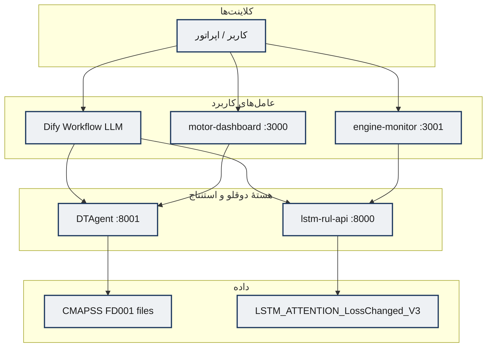
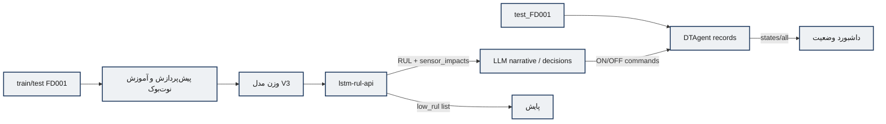
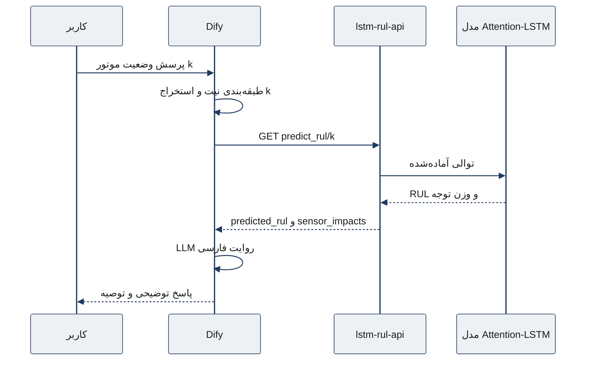
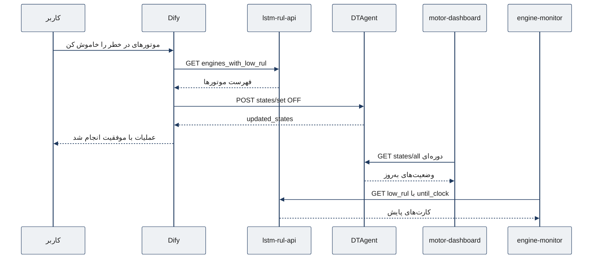

# معماری سامانه و یکپارچه‌سازی سرویس‌ها

**دامنه:** `Implementation/`  
**ارکستراسیون:** `docker-up.sh` / `docker-down.sh`  
**اسناد وابسته:** [`LSTM_RUL_API.md`](LSTM_RUL_API.md)، [`DTAgent.md`](DTAgent.md)، [`Engine_Monitor.md`](Engine_Monitor.md)، [`Motor_Dashboard.md`](Motor_Dashboard.md)، [`LLM_Agent_Dify.md`](LLM_Agent_Dify.md)

این سند برای نگارش فصل پیاده‌سازی و بخش معماری فصل روش‌شناسی تدوین شده است.

---

## ۱. نمای کلی سامانه

سامانهٔ آزمایشگاهی یک **دوقلوی دیجیتال چندعاملی** روی دادهٔ NASA CMAPSS-FD001 است که چهار قابلیت را یکپارچه می‌کند:

1. استنتاج RUL با LSTM+Attention و تابع زیان محافظه‌کارانه  
2. نگه‌داری وضعیت زندهٔ موتورها (ON/OFF) به‌عنوان دوقلوی کنترلی  
3. پایش شبه‌بی‌درنگ موتورهای کم‌عمر  
4. تعامل زبان طبیعی برای پرس‌وجو و فرمان‌های سطح‌بالا  

### ۱.۱ نگاشت به لایه‌های مفهومی پایان‌نامه

| لایه مفهومی | تحقق پیاده‌سازی |
|-------------|-----------------|
| موجودیت / جمع‌آوری داده | فایل‌های CMAPSS + DTAgent (سری زمانی) + `until_clock` |
| ادغام | پیش‌پردازش داخل نوت‌بوک آموزش؛ در سرویس: آماده‌سازی توالی و هنجارسازی ذخیره‌شده |
| عامل دوقلو | DTAgent (state) + LSTM API (وضعیت پیش‌بینانه) |
| عامل کاربرد — پیش‌بینی | `lstm-rul-api` |
| عامل کاربرد — پایش | `engine-monitor` |
| عامل کاربرد — زبان طبیعی | Dify Workflow |
| عامل کاربرد — شبیه‌سازی/وضعیت | `motor-dashboard` (+ دموهای ورودی) |

---

## ۲. پشته فناوری (Tech Stack)

| لایه | فناوری |
|------|--------|
| آموزش مدل | Python، TensorFlow/Keras ۲٫۱۷، pandas، scikit-learn، Jupyter |
| API پیش‌بینی | FastAPI، Uvicorn، TensorFlow Serving-in-process |
| API دوقلو | FastAPI، pandas |
| عامل زبانی | Dify (workflow)، مدل‌های OpenAI (`gpt-4o-mini`, `gpt-4.1-mini`, `gpt-4.1-nano`) |
| UI پایش | React 18 + CRA + nginx |
| UI وضعیت | React 18 + Vite + nginx |
| ارکستراسیون | Docker Compose، Bash (`HOST_IP`) |
| داده | NASA CMAPSS FD001 (`train/test/RUL`) |

### ۲.۱ پورت‌ها و سرویس‌های `docker-up.sh`

| ترتیب | Compose | سرویس | پورت میزبان |
|------|---------|--------|-------------|
| 1 | `DTAgent/docker-compose.yaml` | `dt-engine-api` | **8001** |
| 2 | `lstm-rul-api/docker-compose.yaml` | `lstm-rul-api` | **8000** |
| 3 | `dify/docker/docker-compose.yaml` | پشتهٔ Dify (nginx و وابسته‌ها) | **80 / 443** (+ سرویس‌های داخلی DB/Redis/…) |
| 4 | `motor-dashboard/docker-compose.yaml` | `motor-dashboard` | **3000** |
| 5 | `engine-monitor/docker-compose.yaml` | `engine-monitor` | **3001** |

`HOST_IP` (نمونه در اسکریپت: `10.226.63.45`) برای URLهای قابل‌دسترس از مرورگر و Dify تنظیم می‌شود.

### ۲.۲ نیازمندی‌های زیرساخت (Infrastructure)

| مورد | توصیهٔ عملی مشاهده‌شده در پروژه |
|------|----------------------------------|
| سیستم‌عامل میزبان | Linux با Docker Engine (اسکریپت‌های `.sh`) |
| شبکه | IP ثابت/قابل‌روت برای کلاینت‌های UI و Dify |
| CPU/RAM | آموزش LSTM روی GPU/Colab انجام شده؛ استنتاج API روی CPU قابل اجراست ولی نیازمند RAM کافی برای بارگذاری مدل TF |
| دیسک | حجم مدل (`AiModels`) + دادهٔ CMAPSS + حجم‌های Dify (Postgres/Weaviate) |
| وابستگی خارجی | کلید API مدل‌های زبانی در Dify |

---

## ۳. دیاگرام مؤلفه‌ها (Component Diagram)

---

## ۴. دیاگرام جریان داده (Data Flow)

---

## ۵. دیاگرام توالی — پرس‌وجوی وضعیت موتور

---

## ۶. دیاگرام توالی — خاموش کردن موتورهای در خطر

---

## ۷. ماتریس یکپارچه‌سازی

| مبدأ → مقصد | پروتکل | پیکربندی |
|-------------|--------|----------|
| Dify → LSTM | HTTP GET | `lstm_host_addr` |
| Dify → DTAgent | HTTP POST | `dt_host_addr` |
| engine-monitor → LSTM | HTTP GET (مرورگر) | `REACT_APP_API_BASE_URL` |
| motor-dashboard → DTAgent | HTTP GET (مرورگر) | `VITE_API_URL` |
| docker-up → همه | Compose | `HOST_IP` |
| init-dt → Eclipse Ditto | HTTP PUT | `localhost:8080` (**خارج از up فعلی**) |

---

## ۸. مدیریت خطا در سطح سامانه

| الگو | محل | پیامد |
|------|-----|--------|
| خطای نرم JSON (`{"error":...}`) با HTTP 200 | LSTM API، برخی مسیرهای DTAgent | کلاینت باید بدنه را بررسی کند |
| Fallback دمو در UI | engine-monitor | جلوگیری از خالی شدن داشبورد هنگام قطع API |
| Retry روی HTTP nodes | Dify | تحمل خطای موقت شبکه |
| پیام ثابت موفقیت/شکست | Dify IF/ELSE روی status_code | تجربهٔ کاربری ساده برای فرمان‌ها |

---

## ۹. نکات نگارشی برای فصل‌های پایان‌نامه

- در **روش‌شناسی:** از دیاگرام‌های مؤلفه و توالی همین سند استفاده شود؛ بدون ذکر Docker به‌عنوان نوآوری.
- در **پیاده‌سازی:** جدول پورت‌ها، ماتریس یکپارچه‌سازی و تمایز DTAgent در برابر Ditto آورده شود.
- در **ارزیابی:** به تصاویر `Docs/Images` و آمار Latency در [`Experimental_Results.md`](Experimental_Results.md) ارجاع شود.
