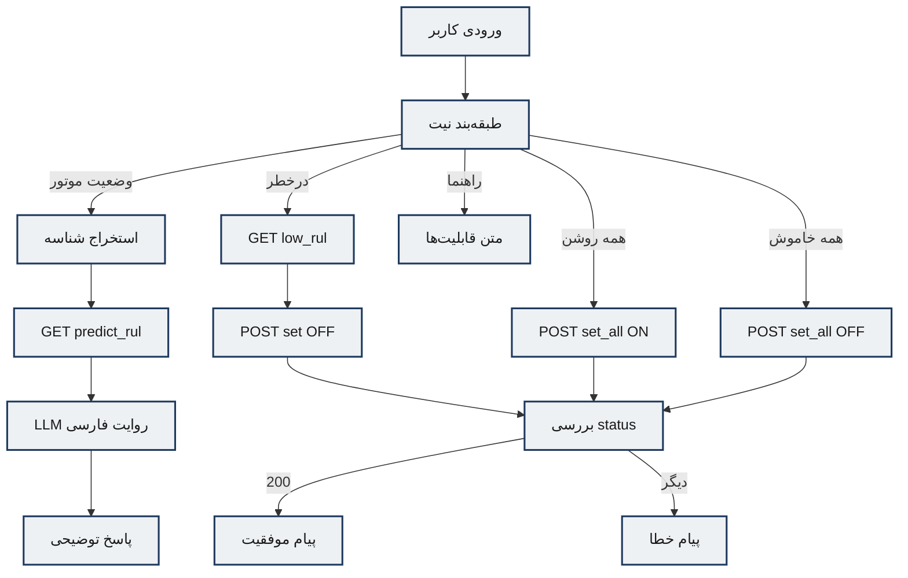
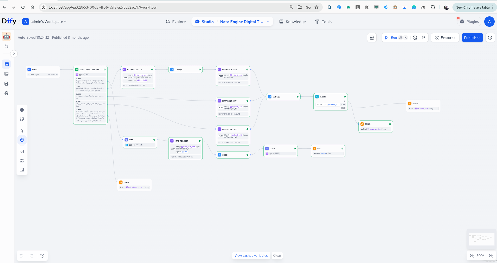
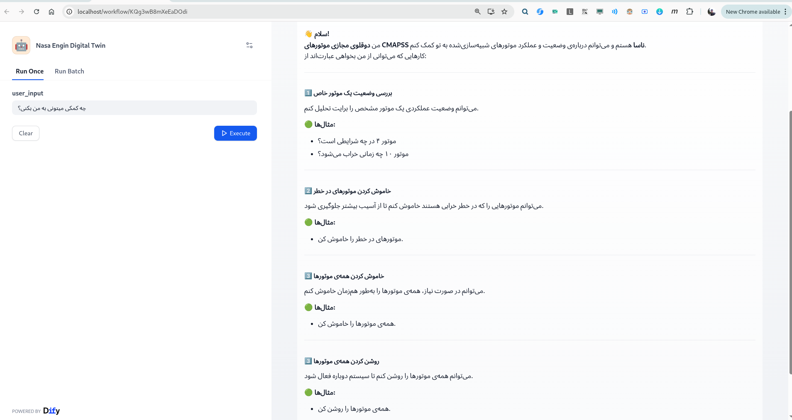
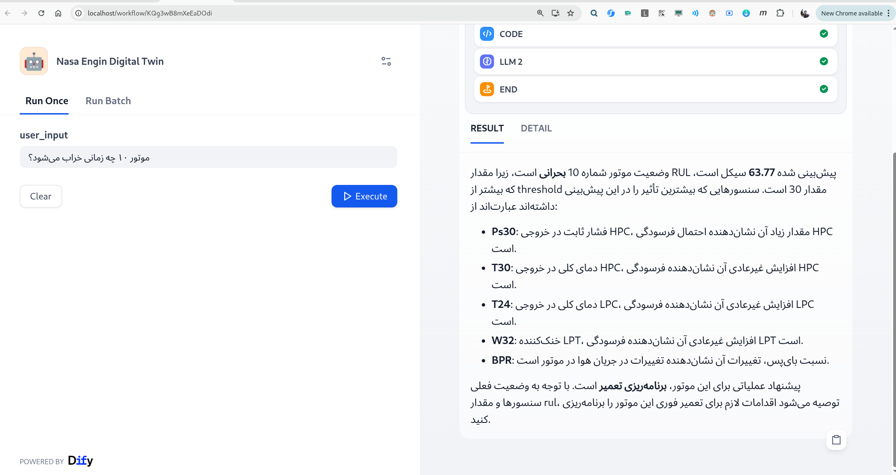

# عامل تعامل زبان طبیعی (LLM Agent / Dify Workflow)

**منبع طراحی:** `Implementation/Dify DSL Backups/Nasa Engine Digital Twin.yml`  
**نمونه‌های پرسش‌وپاسخ:** `Implementation/Docs/LLM Agent.md`  
**گزارش تأخیر:** `Implementation/Docs/LLMAgent Response Time Report.csv`  
**پلتفرم اجرا:** پشتهٔ Dify (از طریق `dify/docker` در `docker-up.sh`) — پورت‌های عمومی nginx: `80` / `443`

---

## ۱. روش‌شناسی (Methodology)

### ۱.۱ الگوی عاملی

عامل زبانی به‌صورت **Workflow Agentic** پیاده‌سازی شده است، نه حلقهٔ آزاد ReAct با tool schema پویا. جریان تصمیم:

1. طبقه‌بندی نیت پرسش کاربر (Question Classifier)
2. اجرای شاخهٔ قطعی شامل گره‌های HTTP (ابزارهای ثابت)
3. در شاخهٔ وضعیت موتور: تولید پاسخ توضیحی مبتنی بر RUL و سهم حسگرها

این طراحی کنترل‌پذیری و قابلیت استناد صنعتی را افزایش می‌دهد و از فراخوانی‌های نامحدود مدل می‌کاهد.

### ۱.۲ فضای نیت‌ها (Intent Space)

| کلاس | معنا | اقدام بعدی |
|------|------|------------|
| 1 | وضعیت یک موتور مشخص | استخراج شناسه → پیش‌بینی RUL → روایت فارسی |
| 2 | خاموش کردن موتورهای در خطر | low-RUL → `states/set OFF` |
| Turn all ON | روشن کردن همه | `states/set_all ON` |
| Turn all OFF | خاموش کردن همه | `states/set_all OFF` |
| Help / Other | قابلیت‌ها یا خارج از حوزه | پاسخ ثابت معرفی |

مدل طبقه‌بند: `gpt-4o-mini`.

### ۱.۳ استراتژی پرامپت

**الف) استخراج شناسه موتور (LLM کوچک):**  
فقط عدد انگلیسی شناسه را از جملهٔ فارسی برمی‌گرداند — کاهش hallucination در مسیر URL.

**ب) روایت پیش‌آگاهی (LLM 2):**  
نقش: متخصص prognostics توربوفن CMAPSS. ورودی‌ها: شماره موتور، RUL، بدنهٔ JSON سهم حسگرها، آستانه. خروجی فارسی با سه بخش الزامی:
1. مقایسهٔ RUL با \(\theta\) (عادی / نیازمند برنامه‌ریزی / بحرانی)
2. بولت‌های top-k حسگر با تفسیر فیزیکی (بر اساس افسانهٔ ۲۱ حسگر)
3. دقیقاً یک توصیهٔ عملیاتی پررنگ:
   - RUL > θ → **ادامه پرواز**
   - θ/2 < RUL ≤ θ → **برنامه‌ریزی تعمیر**
   - RUL ≤ θ/2 → **بازرسی فوری**

**ج) مدیریت Context:**  
Context عمدتاً ساختاری است (خروجی HTTP + متغیرهای env)، نه حافظهٔ محاورهٔ بلند. متغیرهای محیطی کلیدی:

| متغیر | نقش | نمونه |
|-------|-----|--------|
| `lstm_host_addr` | میزبان API پیش‌بینی | `10.226.63.45:8000` |
| `dt_host_addr` | میزبان دوقلو | `10.226.63.45:8001` |
| `threshold` | آستانهٔ بحرانی | ۳۰ |
| `sesor_reson_number` | تعداد حسگر در روایت | ۵ |
| `response_done` / `response_faild` | پیام موفقیت/شکست فرمان | متون فارسی ثابت |
| `not_related_questoin` | پاسخ معرفی/خارج از حوزه | متن چندقابلیتی |

### ۱.۴ دیاگرام جریان انتزاعی

---

## ۲. پیاده‌سازی (Implementation)

### ۲.۱ ساختار DSL

فایل YAML از نوع `app` / mode=`workflow` / DSL `0.4.0` است. گره‌های اصلی:

| نوع گره | نقش |
|---------|-----|
| `start` | متغیر `user_input` |
| `question-classifier` | مسیریابی ۵کلاسه |
| `llm` | استخراج شناسه / روایت |
| `http-request` | ابزارهای REST به LSTM و DTAgent |
| `code` | پارس JSON و تجمیع status |
| `if-else` | موفقیت فرمان |
| `end` | خروجی نهایی |

### ۲.۲ نگاشت Tool-like HTTP

| گره | Method | URL مفهومی |
|-----|--------|------------|
| HTTP 1 | GET | `/api/predict/predict_rul/{id}` |
| HTTP 2 | GET | `/api/predict/engines_with_low_rul/?threshold=` |
| HTTP 3 | POST | `/engines/states/set?state=OFF` + body لیست |
| HTTP 4 | POST | `/engines/states/set_all?state=ON` |
| HTTP 5 | POST | `/engines/states/set_all?state=OFF` |

Retry معمول: `max_retries: 3`؛ احراز هویت: `no-auth` روی شبکهٔ داخلی.

### ۲.۳ یکپارچه‌سازی با UI

- پس از فرمان ON/OFF، `motor-dashboard` با polling وضعیت را نشان می‌دهد.
- `engine-monitor` مستقل از Dify، low-RUL را از LSTM می‌خواند؛ در دموها هم‌زمان دیده می‌شود.

### ۲.۴ تصویر ورک‌فلو

**تحلیل فنی:** تصویر گراف گره‌های طبقه‌بند، LLM، HTTP و End را نشان می‌دهد و با ساختار DSL پشتیبان هم‌خوان است؛ شواهد مستقیمی برای ادعای «عامل مبتنی بر workflow با شاخه‌های تصمیم صریح» فراهم می‌کند.

---

## ۳. ارزیابی و نتایج (Results)

### ۳.۱ مطالعهٔ موردی پرسش‌وپاسخ

جزئیات کامل در `LLM Agent.md`؛ خلاصهٔ تحلیلی:

#### Case A — معرفی قابلیت‌ها
- **پرسش:** چه کمکی می‌توانی به من بکنی؟
- **رفتار:** شاخهٔ Help؛ فهرست چهار قابلیت با مثال.
- **شواهد:**  
  

#### Case B — وضعیت موتور سالم (موتور ۱)
- **RUL گزارش‌شده:** ۱۶۴٫۶۷ > ۳۰ → حالت عادی
- **حسگرهای مؤثر:** T30، Ps30، NRf، سپس W31 و Nf
- **توصیه:** ادامه پرواز با نظارت
- **ارزیابی کیفی:** پاسخ ساختار سه‌بخشی پرامپت را رعایت کرده و به آستانه استناد می‌کند.

#### Case C — وضعیت موتور بحرانی (موتور ۲۴)
- **RUL گزارش‌شده:** ۲۷٫۴۱ < ۳۰ → بحرانی
- **حسگرها:** Ps30، T30، T24، BPR، phi با تفسیر فیزیکی
- **توصیه:** بازرسی فوری
- **ارزیابی کیفی:** تمایز صحیح نسبت به Case B؛ نشان‌دهندهٔ حساسیت شاخه به مقدار RUL.

#### Case D — وضعیت موتور ۱۰ (شواهد تصویری)

#### Case E — فرمان‌های کنترلی
| فرمان | پاسخ عامل | تصویر |
|-------|-----------|--------|
| همه را خاموش کن | عملیات با موفقیت انجام شد | `Images/تصویر مربوط به فرمان همه موتور‌ها را خاموش کن.png` |
| همه را روشن کن | عملیات با موفقیت انجام شد | `Images/تصویر مربوط به فرمان همه موتور‌ها را روشن کن.png` |
| موتورهای در خطر را خاموش کن | عملیات با موفقیت انجام شد | `Images/تصویر مربوط به فرمان همه موتور‌های در خطر خرابی را خاموش کن در عامل زبان طبیعی.png` |

بازخورد پایش پس از این فرمان‌ها در `Engine_Monitor.md` آمده است.

### ۳.۲ آمار زمان پاسخ (Latency)

منبع: `LLMAgent Response Time Report.csv` (۳۰ درخواست)

| شاخص | مقدار |
|------|--------|
| تعداد درخواست‌ها | ۳۰ |
| نرخ موفقیت | ۳۰/۳۰ = **۱۰۰٪** (`status=succeeded`) |
| نرخ خطا | **۰٪** |
| میانگین Latency | **۵٫۸۳ s** |
| میانه | **۶٫۰۰ s** |
| انحراف معیار | **۲٫۸۳ s** |
| حداقل | **۱٫۹۴ s** |
| حداکثر | **۱۱٫۱۱ s** |
| P90 | **۹٫۸۶ s** |
| P95 | **۱۰٫۳۶ s** |

**تفسیر:** تأخیر چندثانیه‌ای با زنجیرهٔ Classifier + (اختیاری) LLM استخراج + HTTP مدل + LLM روایت سازگار است. شاخه‌های فرمان خالص (بدون روایت طولانی) معمولاً در سمت پایین توزیع قرار می‌گیرند؛ شاخه‌های وضعیت موتور به سمت P95 می‌روند.

### ۳.۳ دموی یکپارچه

`Demos/دموی عامل زبان طبیعی به همراه عامل پایش بی درنگ دوقلوهای دیجیتال.webm`
