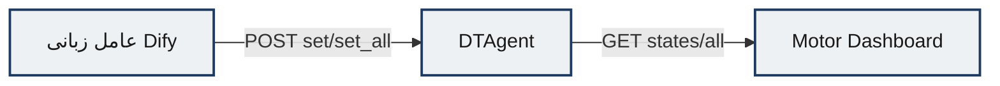

# داشبورد وضعیت و شبیه‌سازی ورودی داده (Motor Dashboard)

**مسیر کد:** `Implementation/motor-dashboard/`  
**پورت UI:** `3000`  
**منبع داده وضعیت:** DTAgent (`:8001`)

> در مستندات دمو، این جزء با عنوان «عامل شبیه‌سازی ورودی داده» نیز دیده می‌شود؛ از نظر معماری، نقش اصلی آن نمایش وضعیت کنترلی دوقلو (ON/OFF) و بازخورد فرمان‌های عامل زبانی است. شبیه‌سازی جریان حسگری زمان‌مند عمدتاً در ترکیب DTAgent + پارامتر `until_clock` در LSTM API و UI پایش تحقق یافته است.

---

## ۱. روش‌شناسی (Methodology)

### ۱.۱ هدف

داشبورد وضعیت، نگاشت زندهٔ حالت گسستهٔ هر موتور را برای اپراتور فراهم می‌کند:

\[
\text{UI}_k = \begin{cases}
\text{RUNNING} & s_k=\mathrm{ON}\\
\text{STOPPED} & s_k=\mathrm{OFF}
\end{cases}
\]

این لایه بازخورد بصری تصمیم‌های عامل زبانی (روشن/خاموش کردن انتخابی یا سراسری) را بدون دخالت مستقیم در استنتاج RUL فراهم می‌کند.

### ۱.۲ الگوی به‌روزرسانی

داشبورد فقط‌خواندنی است و با دورهٔ ثابت (۳۰ ثانیه) وضعیت را از DTAgent می‌گیرد. فیلترهای ALL / ONLINE / OFFLINE برای تمرکز اپراتور روی زیرمجموعه‌ها تعبیه شده‌اند.

### ۱.۳ جایگاه در جریان داده



---

## ۲. پیاده‌سازی (Implementation)

### ۲.۱ پشته فناوری

| جزء | فناوری |
|-----|--------|
| UI | React 18 + Vite 4 |
| HTTP | axios ^1.6 |
| سرو | nginx + `envsubst` برای runtime config |
| Compose env | `VITE_API_URL=http://${HOST_IP}:8001/engines` |

### ۲.۲ ساختار کلیدی

```
motor-dashboard/
├── src/
│   ├── App.jsx              # حلقهٔ fetch + Retry
│   ├── services/api.js      # getMotorStates → /states/all
│   └── components/
│       ├── MotorGrid/       # فیلتر و آمار
│       ├── MotorCard/       # کارت RUNNING/STOPPED
│       └── Header/
├── config.js.template
├── docker-entrypoint.sh
└── docker-compose.yaml      # 3000:80
```

### ۲.۳ مدیریت خطا

- شکست axios به `Error('Failed to fetch motor data: ...')` تبدیل می‌شود.
- UI پیام خطا و دکمه Retry نمایش می‌دهد.
- در توسعه، fallback قدیمی به `localhost:3001/api` در کد دیده می‌شود؛ در Docker با env override می‌شود.

---

## ۳. ارزیابی و نتایج (Results)

### ۳.۱ شواهد بصری شبیه‌سازی / وضعیت

| موضوع | فایل |
|-------|------|
| نمای عامل/داشبورد شبیه‌سازی ورودی | `Images/عامل شبیه‌سازی ورودی داده.png` |
| دموی ویدیویی تنظیمات مشخص | `Demos/عامل شبیه‌سازی ورود داده با تنظیمات مشخص.webm` |

**تحلیل فنی:** تصویر و دمو نشان می‌دهند که اپراتور می‌تواند وضعیت ورودی/موتورها را در رابط گرافیکی مشاهده کند و پس از فرمان‌های سطح‌بالا، تغییر حالت موتورها قابل ردیابی است. این جزء نقش «آینهٔ وضعیت» در حلقهٔ دوقلو را ایفا می‌کند.

### ۳.۲ محدودیت‌ها

- تأخیر بازخورد تا ۳۰ ثانیه (دورهٔ polling) دارد؛ برای دموی هم‌زمان با عامل زبانی ممکن است نیاز به Refresh دستی باشد.
- هیچ فرمان کنترلی از خود UI صادر نمی‌شود؛ منبع حقیقت وضعیت، DTAgent است.
