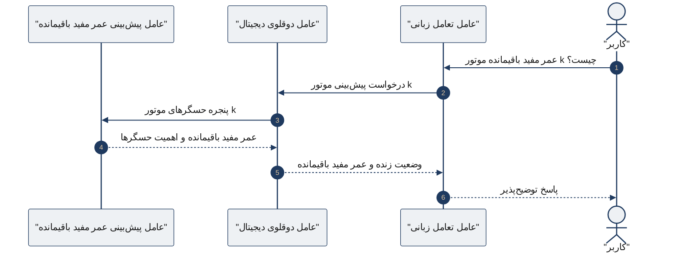
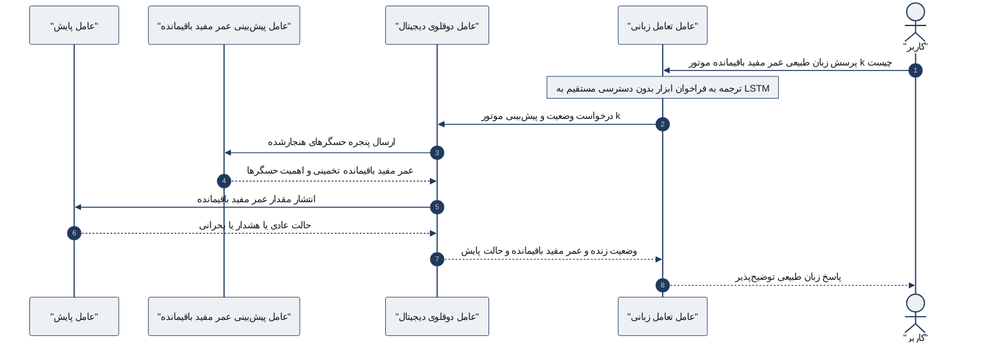

# دیاگرام توالی تعامل عامل‌ها برای پرس‌وجوی پیش‌بینی عمر مفید باقیمانده

این شکل **دیاگرام توالی (sequenceDiagram)** است. سناریو: کاربر با زبان طبیعی عمر مفید باقیمانده موتور k را می‌پرسد. عامل زبانی به مدل LSTM دسترسی مستقیم ندارد و فقط از طریق عامل دوقلو و عامل پیش‌بینی عمل می‌کند.

ترتیب `participant` از چپ به راست است تا **کاربر سمت راست** قرار گیرد.

## تبدیل آنلاین به PNG/SVG

1. برو به [mermaid.live](https://mermaid.live)
2. محتوای یکی از فایل‌های زیر را باز کن و **همه را** در ویرایشگر بچسبان:
   - **فشرده:** `arch_sequence_compact.mmd`
   - **کامل (با عامل پایش):** `arch_sequence_full.mmd`
3. از منوی Actions گزینه **PNG** یا **SVG** را بگیر
4. فایل را با نام `arch_sequence.png` در همین پوشه ذخیره کن

> Mermaid در sequenceDiagram HTML و کاراکتر RTL نامرئی را پشتیبانی نمی‌کند؛ متن فارسی ساده داخل `"..."` کافی است. اگر متن در PNG کمی چپ‌چین بود، SVG را در Inkscape باز کن و روی متن `direction: rtl` بگذار.

---

## نسخه فشرده (فقط مسیر پرس‌وجو)

فایل آماده: `arch_sequence_compact.mmd`

## نسخه کامل (با عامل پایش)

فایل آماده: `arch_sequence_full.mmd`

برای عنوان فعلی شکل در فصل ۳، **نسخه فشرده** مناسب‌تر است.

## راهنمای LaTeX

- خروجی: `images/arch_sequence.png` (حداقل ۳۰۰ dpi)
- در `chap3.tex` مسیر شکل: `images/arch_sequence.png`
