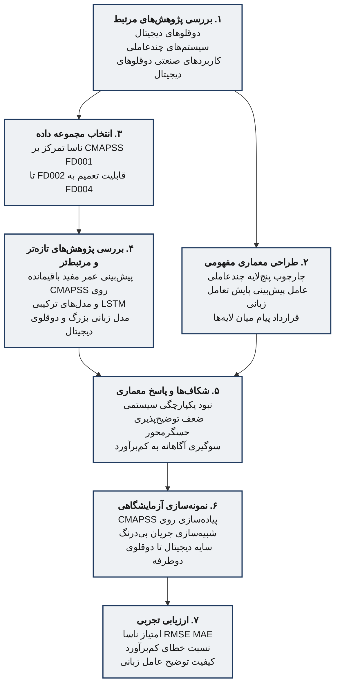
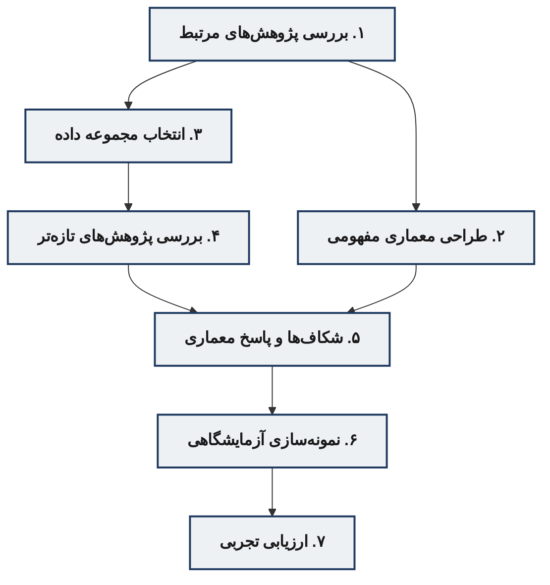

# مسیر کلی پژوهش از بررسی ادبیات تا ارزیابی تجربی

نمودار روش‌شناسی پایان‌نامه در **هفت مرحله** است. دو مسیر موازی پس از مرور اولیه از هم جدا می‌شوند و در شناسایی شکاف‌ها به هم می‌رسند:

- مسیر داده: بررسی ادبیات ← انتخاب مجموعه داده ← پژوهش‌های تخصصی‌تر ← شکاف‌ها
- مسیر معماری: بررسی ادبیات ← طراحی مفهومی ← شکاف‌ها
- مسیر تحقق: پاسخ معماری به شکاف‌ها ← نمونه‌سازی ← ارزیابی



## نسخه فشرده برای شکل پایان‌نامه



## شرح مراحل

| مرحله | محتوا | خروجی |
|--------|--------|--------|
| ۱ | مرور مبانی دوقلوی دیجیتال، سیستم چندعاملی و کاربردهای صنعتی | نقشه ادبیات اولیه و واژگان مشترک |
| ۲ | انتخاب CMAPSS به‌عنوان بستر آزمایش؛ تمرکز اصلی روی FD001 | مسئله مشخص پیش‌بینی عمر مفید باقیمانده |
| ۳ | مرور کارهای جدیدتر روی CMAPSS، LSTM و ترکیب مدل زبانی بزرگ با دوقلو | ادبیات مسئله‌محور پس از تثبیت داده |
| ۴ | طراحی پنج لایه و چهار نقش کاربرد: پیش‌بینی، پایش، تعامل زبانی، شبیه‌سازی جریان | معماری مفهومی مستقل از ابزار پیاده‌سازی |
| ۵ | تطبیق شکاف‌های فصل ۲ با معماری: یکپارچگی چندعاملی، توضیح حسگرها، سوگیری محافظه‌کارانه به کم‌برآورد | پرسش‌های قابل‌پاسخ در سطح طراحی |
| ۶ | پیاده‌سازی آزمایشگاهی روی داده شبیه‌سازی‌شده؛ حرکت از سایه دیجیتال یک‌طرفه به ارتباط دوطرفه در شبیه‌سازی | نمونه قابل‌اجرا برای فصل ۴ |
| ۷ | سنجش پیش‌بینی، رفتار سوگیری خطا و کیفیت تعامل زبانی | نتایج کمی و کیفی فصل ۵ |

## یال‌ها

```
۱ → ۲   پس از ادبیات عمومی، بستر داده انتخاب می‌شود
۱ → ۴   همان ادبیات، طراحی معماری مفهومی را تغذیه می‌کند
۲ → ۳   با معلوم شدن CMAPSS، مرور به کارهای تخصصی‌تر محدود می‌شود
۳ → ۵   ادبیات مسئله‌محور شکاف‌ها را دقیق می‌کند
۴ → ۵   معماری طراحی‌شده همان شکاف‌ها را هدف می‌گیرد
۵ → ۶   پاسخ طراحی وارد نمونه‌سازی می‌شود
۶ → ۷   نمونه آزمایشگاهی ارزیابی می‌شود
```

## راهنمای تبدیل به تصویر

- خروجی پیشنهادی: `images/method_flow.png` یا PDF برداری، حداقل ۳۰۰ dpi
- پس از ساخت فایل، مسیر شکل در `chap3.tex` را از `images/DT_1.png` به `images/method_flow.png` تغییر دهید
- این نمودار مسیر پژوهش است؛ معماری پنج‌لایه شکل جداگانه است (`fig:arch-5layers`)
- برای صفحه پایان‌نامه نسخه فشرده خواناتر است؛ جزئیات هر جعبه در نسخه کامل در همین فایل مانده است
