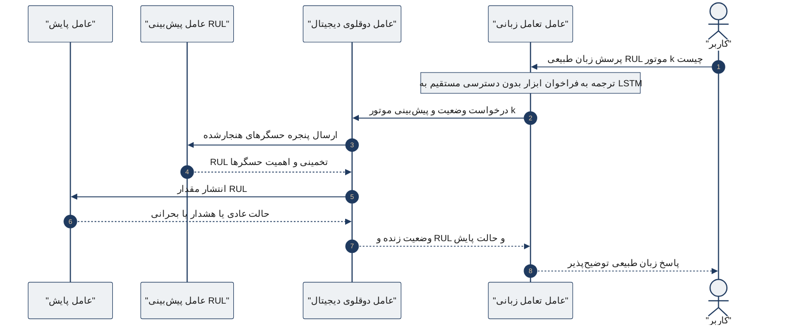
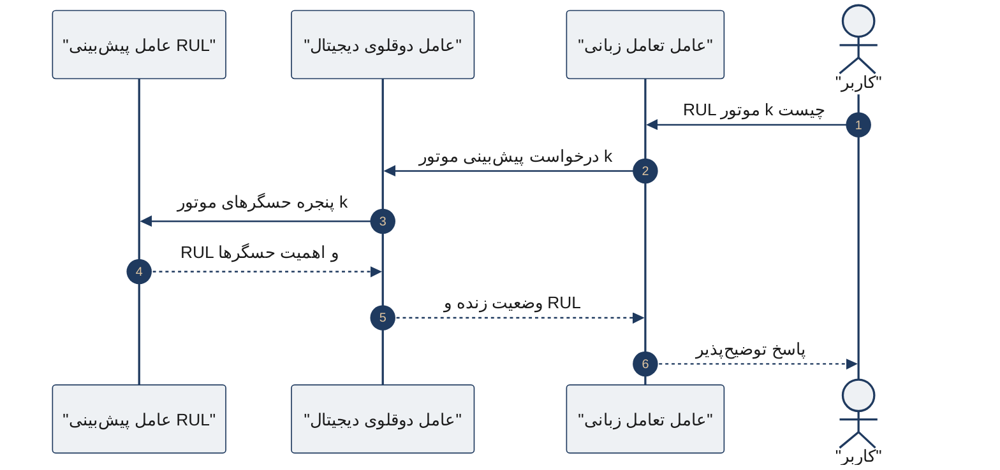
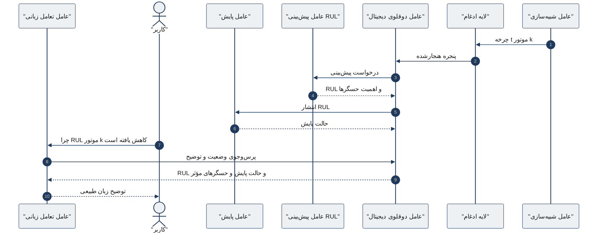

# دیاگرام توالی تعامل عامل‌ها برای پرس‌وجوی پیش‌بینی RUL

این شکل **دیاگرام توالی (sequenceDiagram)** است. سناریو: کاربر با زبان طبیعی عمر مفید باقیمانده موتور k را می‌پرسد. عامل زبانی به مدل LSTM دسترسی مستقیم ندارد و فقط از طریق عامل دوقلو و عامل پیش‌بینی عمل می‌کند.

شرکت‌کننده‌ها از راست به چپ چیده شده‌اند تا خوانش فارسی راست‌چین باشد.

## نسخه فشرده (فقط مسیر پرس‌وجو)

## نسخه گسترش‌یافته (سناریوی سرتاسری)

از ورود چرخه تا پرسش «چرا RUL کاهش یافته است».

برای عنوان فعلی شکل در فصل ۳، **نمودار اول یا فشرده** مناسب‌تر است.

## راهنمای تبدیل به تصویر

- خروجی: `images/arch_sequence.png` (حداقل ۳۰۰ dpi)
- پس از ساخت فایل، در `chap3.tex` مسیر این شکل را از `images/DT_1.png` به `images/arch_sequence.png` تغییر دهید
